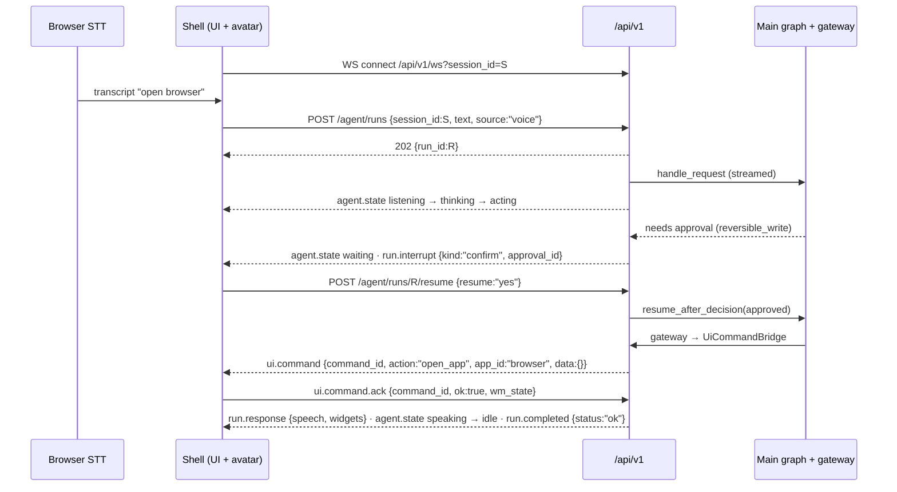

# 07 - API flow (shell ⇄ engine)

> **Status key:** endpoints, event names and payloads below are **Implemented** in `apps/engine/backend/api/` and covered by `tests/systems/test_api_flow.py`. Items marked **Open decision** still need a team call.
>
> **Source of truth:** the team diagram `agent-langgraph.excalidraw` ("API FLOW" section). Payloads and enum values here follow it exactly; where the engine differs underneath, that is listed in "Known limits".

This page is the contract between the React shell (and voice) and the Python engine. It sits *in front of* the main graph from [03 - How it works](03-how-it-works.md); it does not change routing, policy, or the gateway. It adds three things:

1. **Runs.** A run is one user interaction. It may span several engine requests (C1) when the graph pauses for a human and continues.
2. **One WebSocket per session** that narrates the run as it happens. The avatar listens to `agent.state`, and the shell shows interrupts and replies from the other events.
3. **`ui.command` / `ui.command.ack`.** This is how an *approved* native tool call reaches the shell. It plugs into the existing `DesktopBridge` seam, so the gateway stays the only authority path.

```
shell ──REST──▶ /api/v1/agent/runs ─────▶ RunManager ─▶ CoreEngine (main graph)
shell ◀══WS═══ /api/v1/ws ◀── SessionHub ◀── run events, ui.command (from gateway)
shell ══WS═══▶ ui.command.ack, wm.state
```

## Naming rules

- REST: `/api/v1` prefix, plural nouns, `snake_case` JSON fields (`session_id`, never `sessionId`).
- WebSocket event types: lowercase `dot.case` (`agent.state`, `ui.command.ack`).
- IDs: `session_id` (UUID, one per desktop session), `run_id`, `request_id`, `task_id`, `command_id`, `approval_id`, `app_id`.
- Errors everywhere: `{"error": {"code": "...", "message": "...", "details": {}}}`. Codes are the C-contract `ErrorCode` values plus `NOT_FOUND`, `CONFLICT`, `ENGINE_FAILURE` at the API layer.
- Avatar positions on the wire: `top_left`, `top_center`, `top_right`, `center`, `bottom_left`, `bottom_center`, `bottom_right`. The shell's `anchors.ts` uses hyphens (`top-left`), so convert at the edge.
- Source of truth: Python `api/events.py`, mirrored in TypeScript `apps/shell/frontend/src/types/agentEvents.ts`. Change both in one PR.

## REST endpoints

| Method | Path | Body | Returns |
|---|---|---|---|
| `POST` | `/api/v1/agent/runs` | `{session_id, text, source: "voice"\|"text"\|"ui", ui_context?}` | `202 {run_id, session_id, status: "received"}` |
| `GET` | `/api/v1/agent/runs/{run_id}` | – | Run view (status, agent_state, route, request_ids, response, interrupt, errors) |
| `POST` | `/api/v1/agent/runs/{run_id}/resume` | `{resume: "yes"\|"no"\|true\|false}` for confirm, `{resume: "<text>"}` for clarify | `202` run view, `409` if nothing is pending |
| `POST` | `/api/v1/agent/runs/{run_id}/cancel` | – | Run view with `status: "cancelled"`; a pending approval is rejected |
| `GET` | `/api/v1/tools` | – | Registered tool contracts incl. `input_schema` (JSON Schema) |
| `GET` | `/api/v1/health` | – | `{status, service, api_version, model_provider}` |
| `WS` | `/api/v1/ws?session_id={uuid}` | – | Event stream (below). Closes with 1008 for a non-UUID session. |

`ui_context` is optional. When omitted, `ui_context.active_surface` is filled from the session's latest `wm.state.focused_app_id`.

The legacy routes (`/health`, `/desktop/state`, `/agent/invoke`, `/agent/requests`, `/agent/approvals/{id}/decision`) are unchanged.

## WebSocket envelope

Every message, in both directions:

```json
{
  "type": "ui.command",
  "session_id": "3556bf30-6e8e-4381-b1c0-94d7587ad1c2",
  "run_id": "113091db-a7ca-4603-9c64-04a745405e7a",
  "ts": "2026-11-04T19:00:00Z",
  "data": { "command_id": "cmd_c556b4f67440", "action": "open_app", "app_id": "browser" }
}
```

Events only go to sockets of the same `session_id`. If no socket is open, events are dropped, and `GET /agent/runs/{run_id}` is the catch-up path.

### Server → shell

| type | data | When |
|---|---|---|
| `agent.state` | `{state}` | Avatar state changes (deduplicated) |
| `task.progress` | `{task_id, tool_id, status}` | A task finished. `tool_id` is `null` for a task that called no tool. |
| `ui.command` | `{command_id, action, app_id, data}` | An approved native tool needs the shell. **Must be acked.** |
| `run.interrupt` | `{kind: "confirm"\|"clarify", message, options}` | The run is paused for the user |
| `run.response` | `{speech, widgets[]}` | Final answer (speak it, show it). `widgets` is `[]` until tools produce them. |
| `run.completed` | `{status: "ok"\|"failed"\|"cancelled"}` | Always the last event of a run. Details: `GET /agent/runs/{run_id}`. |
| `run.error` | `{error: {code, message, details}}` | Run failed, or *this socket* sent a bad message |

### Shell → server

| type | data | When |
|---|---|---|
| `ui.command.ack` | `{command_id, ok, error?, wm_state?}` | After applying (or refusing) a `ui.command` |
| `wm.state` | `{apps: [{app_id, mode?, …}], focused_app_id}` | On every layout change, and again after reconnect |

### Fixed values

| Name | Values |
|---|---|
| `agent.state` | `idle`, `listening`, `thinking`, `acting`, `waiting`, `speaking`, `error` |
| `source` | `voice`, `text`, `ui` |
| interrupt `kind` | `confirm`, `clarify` |
| task `status` | `queued`, `running`, `done`, `failed`, `skipped` (only `done`/`failed`/`skipped` are emitted today) |
| `run.completed` `status` | `ok`, `failed`, `cancelled` |
| `ui.command` `action` | `open_app`, `close_app`, `focus`, `move`, `resize`, `minimize`, `maximize`, `restore`, `snap`, `set_avatar_position` |
| avatar position | `top_left`, `top_center`, `top_right`, `center`, `bottom_left`, `bottom_center`, `bottom_right` |

REST run `status` (`GET /agent/runs/{run_id}`) is `received`, `running`, `awaiting_input`, `completed`, `failed`, `cancelled`. It is API-level; the engine's request statuses (doc 02 vocabulary) are unchanged underneath, and a run's `request_ids` point at them. C9 task results map to task `status` as `completed` → `done`, `failed` → `failed`, `blocked` → `skipped`.

## Avatar mapping

`agent.state` is derived from main-graph nodes (`NODE_AGENT_STATE` in `api/events.py`):

| Graph moment | `agent.state` |
|---|---|
| mic open (shell-side, no event) | `listening` |
| `ingest_build_context` (diagram: ingest) | `listening` |
| `choose_route`, `clarify`, `supervisor_plan`, `validate_plan`, `bounded_replan`, `synthesize_outcome` (route / plan) | `thinking` |
| `fast_direct_task`, `dispatch_ready_tasks`, approved resume (execute_tool) | `acting` |
| `run.interrupt` pending (confirm / clarify) | `waiting` |
| after `run.response` (respond) | `speaking` → `idle`, then `run.completed` |
| run failed | `error` |
| run cancelled (END) | `idle` |

The shell's avatar art currently has `idle/listening/thinking/speaking/error`. Until new frames exist, render `acting` and `waiting` as `thinking`.

## Sequence: "open browser" spoken, confirmed, applied



## `ui.command` and receipts

`api/ui_bridge.py` implements the existing `DesktopBridge` interface (`invoke_native_command`). The gateway calls it exactly as before, and the outcome maps onto the existing receipt rules:

| What happens | Receipt (C7) |
|---|---|
| No open socket for the session, or the tool has no UI mapping | `failed`, `TOOL_UNAVAILABLE` (provably not started; same as before this layer) |
| Shell acks `ok: true` | `succeeded`; observation includes `transport: "ws"`, `command_id`, `wm_state` |
| Shell acks `ok: false` | `failed`, `ADAPTER_FAILURE` |
| No ack within `NEXUS_UI_ACK_TIMEOUT_MS` (default 2000) | `unknown_outcome`: the shell may have applied it, so it is never re-run blindly |

The shell must therefore ack **every** `ui.command`, including refusals. `engineClient.ts` does this automatically.

### Making another tool UI-backed

1. Register it in `agent/tools/registry.py` with a `native_command_id` (risk, targets and idempotency as usual).
2. Add one line to `NATIVE_TO_UI` in `api/ui_bridge.py` that maps the tool args to `(UiAction, app_id, data)`.
3. Handle that `action` in the shell's `onUiCommand` handler.
4. Add a test next to `test_confirm_then_ui_command_round_trip`.

## Wiring the shell

`apps/shell/frontend/src/shell/agent/engineClient.ts` is a typed client (REST plus a reconnecting socket, with automatic acks). It is **not wired into the shell yet**. The suggested hookup for the Layout and WM owners:

- Create one client per desktop session; call `connect()` on mount.
- `onEvent`:
  - `agent.state` sets the avatar status.
  - `run.interrupt` shows a confirm or clarify bubble.
  - `run.response.speech` is passed to `say()` (and to TTS); `widgets` render in the panel.
  - `run.error` shows the error bubble.
- `onUiCommand`: map `open_app`, `close_app`, etc. to the existing `DesktopStore` methods and return `{ok, wmState}`.
- Call `pushWmState()` from the desktop store subscription.
- Keep `parseCommand`/`runCommand` as the offline fallback while the engine isn't running.

## Not in this layer (owned by other tracks)

| Item | Owner | Note |
|---|---|---|
| `GET/PUT /api/v1/wm/layout` (restore/save layout) | Window manager | Today `sessionPersistence.ts` covers it client-side |
| `POST /api/v1/voice/tts` (Piper) | Voice | STT stays in the browser and sends text to `/agent/runs` |
| `POST /api/v1/web/search`, `/web/browse` | Web search | Register them as tools too, so the agent can call them |
| `GET/POST /api/v1/files…` | Layout | |

## Known limits / open decisions

- **Open decision:** runs are kept in memory (the last 200 finished runs). Engine requests, tasks, approvals and receipts are already durable in SQLite. Persist runs only if the shell needs history across restarts.
- **Open decision:** a clarify answer is treated as the new full instruction ("open browser"), not as a fragment ("browser"). The shell should prefill the original text in the clarify bubble.
- Cancelling mid-execution can leave an execution started without a receipt. The gateway reports it as `unknown_outcome` on the next attempt, which is the intended reconcile path (doc 03 §7).
- **Not yet implemented (Agent-owned in the diagram):** `POST /api/v1/tools/{tool_id}/invoke` and `PATCH /api/v1/tools/{tool_id}`.
- **Engine differs from the diagram's MAIN GRAPH:** the engine's 12 nodes do not use `Send` fan-out, `interrupt()`/`Command(resume=…)`, or `thread_id = session_id`. Confirm goes through the C5 approval service, and a clarify answer starts a child request (`parent_request_id`). The wire contract above is the same either way.
- `session_id` must be a UUID (C1 contract), not a short id like the diagram's `s_8f2c` example.
- Tool ids are flat (`open_application`), not the diagram's `module.action` form.
- `run.response.speech` is the engine's synthesized summary. With `NEXUS_MODEL_PROVIDER=none` it is deterministic and terse, so a model provider or a response template should shape it before TTS.
