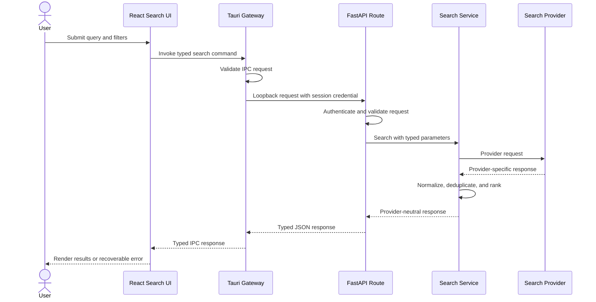
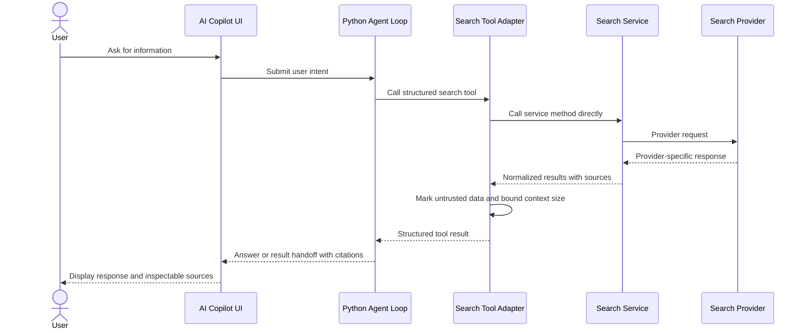
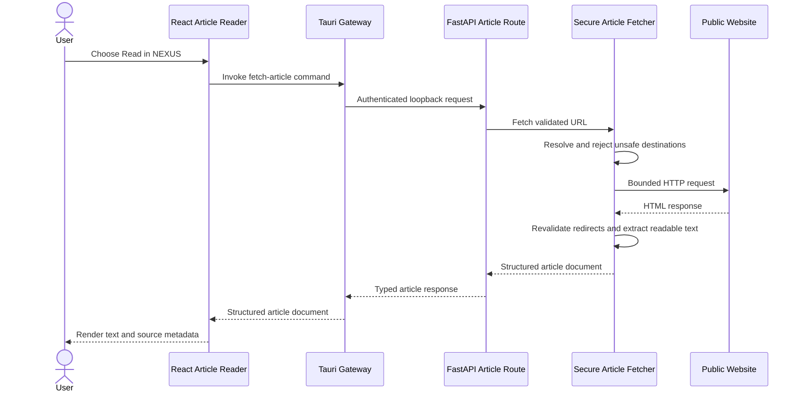

# Search & Discover Architecture

| | |
| --- | --- |
| Status | Approved on October 24, 2026 |
| Scope | Search & Discover subsystem |
| Primary platform | Windows |

## Purpose

Search & Discover retrieves public web information and renders it inside the NEXUS desktop shell. The subsystem supports direct user searches and structured AI tool calls without making either path depend on the other.

The architecture separates presentation, desktop integration, retrieval, and agent orchestration so that:

- Search works when no LLM is configured.
- React never receives provider credentials.
- Provider-specific responses do not leak into the UI or agent contracts.
- Native desktop permissions remain in Rust/Tauri.
- Retrieved content is treated as untrusted data at every boundary.

## Scope

The first implementation covers:

- Web search
- Image search
- Video search
- Mixed-result rendering
- Article retrieval and readable-text extraction
- Structured tools for the AI agent

The following concerns are deferred to later design work:

- AI-generated answers and summaries
- Personalized ranking
- Long-term search history
- Result caching beyond short-lived operational caching
- Interactive browser automation
- Downloading or rehosting third-party media

## Architectural Decisions

| Decision | Rationale |
| --- | --- |
| FastAPI owns retrieval services and provider adapters. | Retrieval, normalization, article extraction, and agent tools already belong to the Python engine. |
| React uses typed Tauri commands in production. | The webview does not need the sidecar address, session credential, or provider credentials. |
| Rust/Tauri is the desktop gateway and sidecar supervisor. | Rust already owns application lifecycle and native capabilities. |
| Python agent tools call retrieval services directly. | The agent does not make an HTTP request back into its own process or duplicate search logic. |
| Search contracts are provider-neutral. | Providers can be changed without rewriting React or agent integrations. |
| Search results use a required `kind` discriminator. | Rendering decisions remain explicit and type-safe. |
| Article content is returned as structured text, not executable page markup. | This reduces script injection and unsafe rendering risk. |
| The sidecar binds only to loopback and requires a per-session credential. | Binding to loopback alone does not prevent unrelated local clients from calling the service. |
| Search behavior does not require an LLM. | Retrieval remains testable, predictable, and usable when AI services are disabled. |

## Runtime Components and Ownership

### React Search & Discover Application

React owns the user experience:

- Search input, filters, result lists, galleries, and reader navigation
- Loading, empty, partial-success, and error states
- Request cancellation and protection against stale responses
- Safe display of normalized result metadata
- Rendering article text without executing retrieved HTML
- Sending user actions through typed Tauri commands
- Asking Tauri to open approved source URLs externally

React does not:

- Store or transmit search-provider credentials
- Call search providers directly
- Discover or hard-code the FastAPI port
- Render arbitrary provider or article HTML
- Decide whether a URL is safe to fetch server-side

### Rust/Tauri Gateway

Rust owns the desktop boundary:

- Starting, monitoring, and stopping the FastAPI sidecar
- Holding the active sidecar address and per-session credential in managed process memory
- Exposing typed search and article commands to the React webview
- Validating the shape and size of IPC requests before forwarding them
- Adding the sidecar session credential to loopback requests
- Applying request deadlines and mapping transport failures to stable desktop errors
- Opening original source URLs through an approved external-browser API
- Preventing arbitrary webview code from constructing unrestricted sidecar requests

Rust does not interpret or rank provider results. It forwards typed requests and responses between trusted application components.

### FastAPI Retrieval Backend

FastAPI owns retrieval behavior:

- Request validation and documented HTTP contracts
- Provider-neutral search services
- Provider adapters and credential loading
- Result normalization, canonicalization, and deduplication
- Pagination, safe-search settings, locale handling, and result limits
- Mixed-search orchestration and partial-success responses
- Secure article fetching and readable-text extraction
- Stable domain errors and HTTP error mapping
- Request IDs, redacted operational logs, and timing information

HTTP route handlers remain thin. Business behavior lives in independently callable services.

### Python AI Tool Layer

The AI integration layer owns:

- Structured tool names, descriptions, and argument schemas
- Mapping tool calls to retrieval service methods
- Compacting or truncating results for model context
- Preserving citations and source URLs
- Marking all retrieved text and metadata as untrusted external content
- Preventing retrieved instructions from changing system policy or tool permissions

Tools import and call the retrieval services directly. They do not call the local FastAPI routes.

### External Providers and Websites

Search providers and public websites are outside the NEXUS trust boundary. Their responses may be malformed, unavailable, misleading, hostile, or subject to changing terms. All provider payloads are normalized before they reach React or the agent.

## Proposed Module Layout

```text
apps/
├── engine/backend/
│   ├── search/
│   │   ├── models.py
│   │   ├── errors.py
│   │   ├── service.py
│   │   ├── article.py
│   │   └── providers/
│   │       ├── base.py
│   │       ├── mock.py
│   │       └── <selected_provider>.py
│   ├── agent/tools/
│   │   └── search_tools.py
│   └── main.py
└── shell/frontend/src/
    ├── internal-apps/search/
    │   └── frontend/src/
    └── types/
        └── search.ts

src-tauri/src/
├── commands/search.rs
└── sidecar.rs

docs/search/
├── architecture.md
└── issues/
```

The exact provider adapter name is selected in Issue 4. Shared HTTP types are defined in Issue 2 and generated from or checked against the FastAPI OpenAPI contract.

## Direct User Search Flow



The direct-search path contains no AI component. A missing or disabled LLM does not affect it.

## AI-Initiated Search Flow



The agent and HTTP routes share service instances and models through dependency injection. Neither path reimplements retrieval.

## Result Selection Flows

### Open the Original Source

1. The user selects **Open source** on a result.
2. React sends the result URL to a dedicated Tauri command.
3. Rust parses the URL and permits only supported external schemes, initially `https` and optionally `http`.
4. Rust asks the operating system to open the URL in the user's default browser.
5. The source does not execute inside the NEXUS webview.

### Read an Article Inside NEXUS



Article fetching validates the initial destination and every redirect. Private, loopback, link-local, and otherwise prohibited network destinations are rejected. Detailed fetch controls are implemented in Issue 10.

## Development and Packaged Transport

### Development

The preferred development path mirrors production:

1. Tauri generates a random per-session credential.
2. Tauri starts the Python engine with the credential in the child-process environment.
3. FastAPI binds to `127.0.0.1` using a configured development port or an OS-assigned port.
4. The sidecar reports readiness and its selected port to Rust through a machine-readable startup handshake.
5. React calls only Tauri IPC.

Backend developers may run FastAPI independently for endpoint tests. Independent mode requires an explicit development session credential and must still bind to loopback. Direct browser access is not a supported application path.

### Packaged Application

1. Rust generates a cryptographically random credential for the process session.
2. Rust launches the packaged Python sidecar with loopback-only binding and an OS-assigned port.
3. The sidecar emits a single machine-readable readiness message containing its port. The credential is never printed.
4. Rust verifies the health endpoint using the session credential and stores the address and credential in managed memory.
5. Search commands become available only after readiness succeeds.
6. Rust monitors the child process and returns a stable `service_unavailable` error if it exits.
7. On application shutdown, Rust requests graceful termination and then applies a bounded forced-stop policy if necessary.

The readiness handshake format and restart policy will be specified with the sidecar implementation. Search requests are not silently retried across sidecar restarts because doing so could duplicate user-visible operations.

## Local API Protection

The local sidecar uses defense in depth:

- Bind only to the IPv4 and, if deliberately supported, IPv6 loopback interfaces.
- Never bind to all interfaces in the desktop application configuration.
- Require a high-entropy per-session bearer credential on non-health routes.
- Keep the credential in Rust and the sidecar process; do not expose it to React.
- Reject browser origins by default; do not enable permissive CORS.
- Limit request-body size, query length, result counts, and concurrent work.
- Apply route-specific timeouts.
- Disable or protect interactive API documentation in packaged builds.
- Redact authorization values, provider keys, and article bodies from logs.
- Return stable public errors without internal stack traces.

The health endpoint reveals only readiness and version-compatible status. It does not expose configuration, provider names, credentials, or desktop state.

## Provider Credentials and Configuration

Provider credentials are loaded only by the FastAPI process from its environment or a future OS-backed secret store.

- Development secrets may be placed in an ignored `.env` file.
- Packaged secrets must not be compiled into frontend assets or committed configuration.
- Credentials are not stored in SQLite as plaintext.
- Provider adapters receive only the credentials they require.
- Credentials are never returned through OpenAPI examples, errors, logs, IPC responses, or agent tool output.
- React may display whether a provider is configured, but never the credential value.

Issue 4 will define provider-specific variables after the provider review.

## External Content Trust Model

All search-provider fields and website content are untrusted, including titles, snippets, URLs, thumbnails, metadata, extracted text, and embedded markup.

| Risk | Required control |
| --- | --- |
| Script or markup injection | Render normalized strings as text. Do not inject provider or article HTML. |
| Unsafe external links | Parse and validate schemes in Rust before opening them outside the webview. |
| Server-side request forgery | Resolve and validate destinations before connecting and after every redirect. |
| Prompt injection | Label retrieved data as untrusted evidence and keep it below system and developer instructions. |
| Tool escalation | Retrieved content cannot grant permissions, change tool schemas, or suppress confirmations. |
| Oversized or slow responses | Enforce time, redirect, byte, result-count, and concurrency limits. |
| Malformed provider data | Validate through Pydantic models and discard or report invalid entries. |
| User tracking through media | Define thumbnail proxying or direct-load behavior before enabling image rendering. |
| Stale UI results | Cancel superseded requests and compare request IDs before updating state. |

An AI-generated answer may use retrieved content as evidence, but it must retain inspectable sources and distinguish retrieval from inference. Answer generation is outside the first retrieval implementation.

## Error and Availability Model

Errors use stable machine-readable codes rather than provider messages. Initial categories include:

- `invalid_request`
- `service_starting`
- `service_unavailable`
- `provider_not_configured`
- `provider_timeout`
- `provider_rate_limited`
- `provider_failure`
- `unsafe_url`
- `unsupported_content`
- `content_too_large`
- `extraction_failed`

Mixed search supports partial success. A failed image or video provider does not discard valid web results. The response includes typed warnings for failed result groups.

The UI maps errors to actionable states such as retrying, configuring a provider, or opening the original source. Provider response bodies and internal stack traces are not displayed to users.

## Observability

Every search and article request receives a request ID that is preserved across Tauri and FastAPI logs. Operational records may include:

- Request ID
- Result kinds requested
- Result counts
- Outcome category
- Provider latency
- Total latency
- Retry and rate-limit metadata

Raw credentials, authorization headers, complete article bodies, and full user queries are excluded from routine logs. Query logging, if introduced for diagnostics, must be opt-in and documented as potentially sensitive.

## Independence from the AI Agent

The retrieval package has no dependency on the agent loop or an LLM provider. FastAPI routes, React integration tests, and provider tests can run with the agent disabled.

The dependency direction is:

```text
FastAPI routes ─┐
                ├──> Search and article services ──> Provider/fetch adapters
AI tool layer ──┘
```

The service layer never imports the agent. This boundary allows Search & Discover to remain useful when hosted AI, Ollama, or all AI functionality is unavailable.

## Review and Approval

The project owner approved the ownership boundaries, transport decisions, and trust model in this document on October 24, 2026. Provider selection, detailed schemas, and implementation-specific library choices remain in their respective implementation issues. Cross-team feedback that changes an approved boundary must be recorded in this document before the affected implementation is merged.
